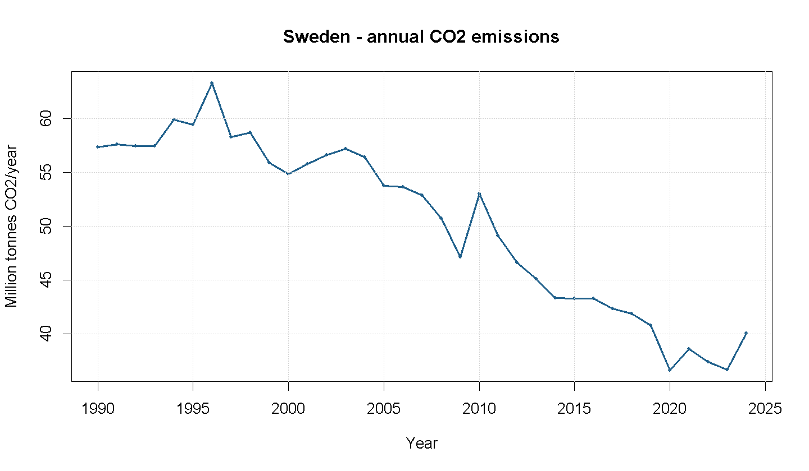
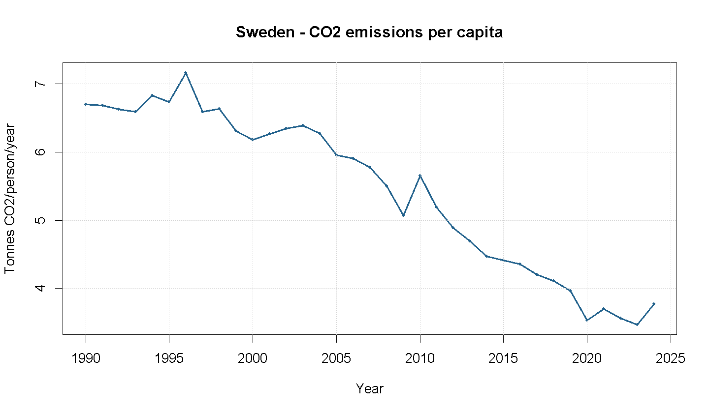
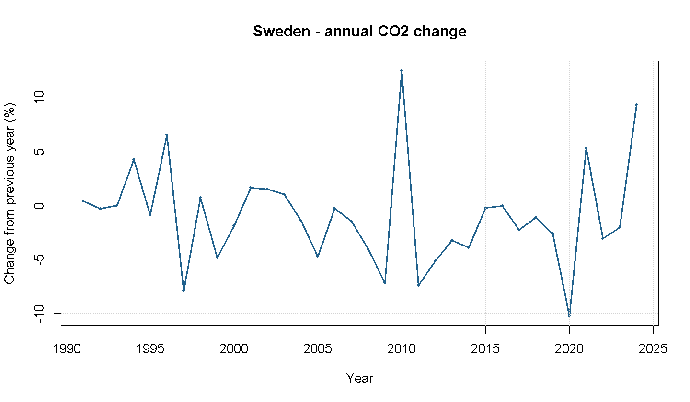

**Student:** Cedric Rene A. Rombines  
**Country / ISO-3:** Sweden / SWE  
**Study period:** 1990–2024  
**Declared to instructor on:** November 14, 2026

# co2-emissions-SWE
Country-level CO₂ emissions analysis for Sweden (1990–2024) using R and Our World in Data.
## Research Question

How have Sweden's annual CO₂ emissions and CO₂ emissions per capita changed from 1990 to 2024?

## Country Information

- **Country:** Sweden
- **ISO-3 Code:** SWE
- **Study Period:** 1990–2024
## Data Source

The data were obtained from Our World in Data's CO₂ and Greenhouse Gas Emissions dataset.

- **Dataset:** `owid-co2-data.csv`
- **Download date:** November 14, 2026
- **Source:** https://github.com/owid/co2-data
- **Country analyzed:** Sweden (SWE)

The full dataset is excluded from GitHub using `.gitignore`. Only the Sweden-specific dataset (`SWE_co2.csv`) will be uploaded to the repository.
## Methods and Software

The analysis was conducted using RStudio and base R functions. The Our World in Data dataset was filtered to include records for Sweden (SWE) from 1990 to 2024.

The analysis included:
- Extracting Sweden's annual CO₂ emissions and per-capita emissions.
- Calculating the year-to-year percentage change in annual CO₂ emissions.
- Identifying the highest and lowest recorded emissions.
- Creating graphs to visualize emissions trends.
- Saving the processed data, summary statistics, and graphs in their respective project folders.

The analysis script is available in `scripts/analyze_co2.R`.
## Results and Interpretation

Sweden's annual CO₂ emissions generally declined between 1990 and 2024. In 1990, emissions were approximately 57.32 million tonnes, compared with 40.05 million tonnes in 2024. This represents an overall decrease of about 30.13%.

The highest annual emissions during the study period occurred in 1996, reaching approximately 63.26 million tonnes. Emissions later declined, reaching their lowest annual total in 2020 at approximately 36.60 million tonnes. However, emissions increased by about 9.32% in 2024 compared with the previous year.

CO₂ emissions per capita also showed a generally declining trend. In 1990, Sweden recorded approximately 6.70 tonnes per person, while the 2024 value was approximately 3.78 tonnes per person. The lowest per-capita value occurred in 2023, at approximately 3.47 tonnes per person.

Overall, the results indicate that Sweden's annual and per-capita CO₂ emissions were lower in 2024 than in 1990. Despite this long-term decline, the increase observed in 2024 shows that emissions did not decrease consistently every year. These findings describe changes in emissions over time but do not establish the specific causes of those changes.

The European Environment Agency (2025) reports that Sweden's greenhouse gas emissions have generally declined due to changes in energy use. These include replacing fossil fuels for heating with district heating and electricity, shifting industrial energy use toward biofuels and electricity, and increasing the use of renewable energy. Improvements in vehicle efficiency and the use of biofuels have also contributed to reductions in transport emissions. These developments provide possible context for the declining trend observed in this analysis, although the EEA's greenhouse gas figures are not identical to the fossil fuel and industrial CO₂ measurements used in this study.

## Limitations

This analysis focuses only on Sweden and covers the period from 1990 to 2024. The dataset contains estimates that may be revised as new information becomes available. The study examines CO₂ emissions from fossil fuels and industrial processes, not all greenhouse gas emissions or emissions from land-use change. The results describe trends and changes over time but cannot independently explain the causes behind them. Missing data were not treated as zero.
## Figures

### Annual CO₂ Emissions



### CO₂ Emissions Per Capita



### Annual Percentage Change


## How to Reproduce the Analysis

1. Clone or download this repository.
2. Download the Our World in Data CO₂ dataset and save it as `data/owid-co2-data.csv`.
3. Open the project in RStudio.
4. Run the following command from the project root:

```r
source("scripts/analyze_co2.R")
```

The script will generate the Sweden-specific dataset, summary statistics, yearly changes, graphs, and session information.

## References

Our World in Data. (n.d.). *CO₂ and Greenhouse Gas Emissions*. https://github.com/owid/co2-data

Our World in Data. (n.d.). *CO₂ and Greenhouse Gas Emissions dataset*. https://owid-public.owid.io/data/co2/owid-co2-data.csv

European Environment Agency. (2025). *Total greenhouse gas emissions (without LULUCF) | Sweden*. Europe's Environment 2025.

https://www.eea.europa.eu/en/europe-environment-2025/countries/sweden/total-greenhouse-gas-emissions